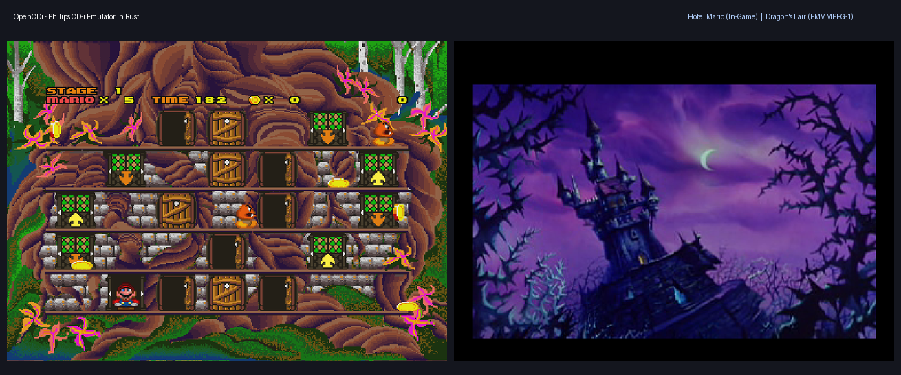

# OpenCDi (Italiano)

[English Version](README.md)

OpenCDi è un emulatore open source per **Philips CD-i** scritto in **Rust**.
L'obiettivo del progetto è preservare e rendere fruibile la libreria software e multimediale del sistema Philips CD-i con un'architettura moderna, veloce e pulita.



---

## Caratteristiche & Architettura

- **CPU:** Philips SCC68070 (set di istruzioni 68000/68010, interrupt autovettorati, timer interni, UART e canali DMA su chip).
- **Video:** Philips MCD-212 Video Display Controller:
  - Rendering a doppio piano (Plane A & Plane B) e backdrop.
  - Formati grafici supportati: CLUT4, CLUT7, CLUT8, Run-Length (7 e 8 bit), DYUV (Delta-YUV) e RGB555.
  - Istruzioni display lista linea per linea ICA (Instruction Control Area) e DCA (Dynamic Control Area).
- **CD-ROM & Audio:**
  - Controller CDIC (CD-i Controller) per la decodifica dei settori Mode 2 Form 1 e Form 2.
  - Filtraggio e riproduzione audio CD-DA e CD-i ADPCM (Livelli A, B e C, stereo e mono).
  - Supporto per immagini disco CHD (formato compresso MAME/MESS) e binari raw.
- **Microcontrollore Slave (68HC05 HLE):**
  - Gestione input per tastiera, mouse e gamepad CD-i.
  - Orologio Real-Time (RTC) e memoria non volatile (NVRAM).
- **Digital Video Cartridge (DVC / MPEG-1):**
  - Emulazione della cartuccia DVC per la riproduzione FMV (Full Motion Video).
  - Demuxer hardware integrato (video pack MPEG-1 e audio layer 2).
  - Decoder video MPEG e pipeline di compositing YUV -> RGB su MCD-212.
- **Frontend GUI:**
  - Finestra interattiva a 50/60 Hz basata su `minifb`.
  - Controlli tastiera, mouse e gamepad.

---

## Compatibilità Verificata

| Titolo | Supporto Video / DVC | Stato Gameplay |
|---|---|---|
| **Hotel Mario** | Grafica MCD212 / CDIC | Pienamente giocabile, audio ADPCM e animazioni complete |
| **Striker Pro** | Grafica MCD212 / CDIC | Menù e gameplay funzionanti, audio sincronizzato |
| **Dragon's Lair (USA)** | DVC FMV MPEG-1 | Attract mode continuo e gameplay con video FMV MPEG attivo |
| **The 7th Guest** | DVC FMV MPEG-1 | Boot, FMV introduttivo e caricamento scene |
| **Rise of the Robots** | Grafica MCD212 / DVC | Boot e sequenze iniziali |
| **Lost Eden** | DVC FMV MPEG-1 / CDIC | Boot, filmati e dialoghi |
| **Burn:Cycle** | DVC FMV MPEG-1 | Boot e sequenze video |

---

## Come Compilare ed Eseguire

### Prerequisiti
- [Rust & Cargo](https://rustup.rs/) (versione 1.70 o superiore).

### Compilazione
```bash
git clone https://github.com/sigsantilio/opencdi.git
cd opencdi
cargo build --release
```

L'eseguibile ottimizzato verrà generato in `target/release/opencdi.exe`.

### File BIOS e ROM
Posizionare i seguenti file BIOS nella cartella `bios/`, `file utili/bios/` o nella cartella dell'eseguibile:
- `cdi220b.rom` (BIOS CD-i 220)
- `vmpega.rom` (ROM del Digital Video Cartridge per i titoli con filmati MPEG)

### Avvio
```bash
cargo run --release -- "percorso/al/gioco.chd"
```
Oppure trascinare direttamente l'immagine `.chd` sull'eseguibile `opencdi.exe`.

---

## Contribuire al Progetto

Questo progetto è guidato dalla passione per la storia del CD-i e dalla ricerca sulla sua architettura hardware.
Tutti i contributi sono i benvenuti:
- Segnalazioni di bug e report di compatibilità di nuovi titoli.
- Pull request per perfezionare timing, interrupt, registri hardware e decoder.
- Documentazione e capture di log da hardware reale.

---

## Licenza

Distribuito sotto licenza **MIT**. Consulta il file `LICENSE` per i dettagli.
